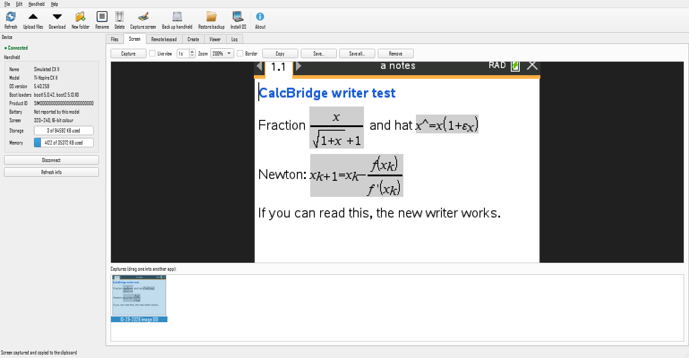
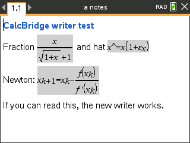

# CalcBridge

**An open-source desktop app for the TI-Nspire CX II** — move files, capture the screen, back up, install
OS updates, drive the calculator from your keyboard, and build documents with real 2D math — on Windows
and macOS, with no TI account or license key.



> CalcBridge is an independent project. It is not affiliated with or endorsed by Texas Instruments.
> TI-Nspire is a trademark of Texas Instruments.

## Download

Get the latest build from the [Releases page](https://github.com/PerChance-Lee/calcbridge/releases):

| System | File | Notes |
|---|---|---|
| Windows 10/11 (64-bit) | `CalcBridge-windows-x64.zip` | Unzip anywhere and run `CalcBridge.exe`. `calcbridge-cli.exe` is the command-line version. No driver needed. |
| macOS on Apple silicon | `CalcBridge-macos-arm64.dmg` | Drag CalcBridge to Applications. See *Opening on a Mac* below. |
| macOS on Intel | `CalcBridge-macos-x86_64.dmg` | Same as above. |

**Opening on a Mac:** the app isn't notarized by Apple, so the first launch is blocked. Double-click it,
choose **Done**, then open **System Settings › Privacy & Security**, scroll down and click **Open Anyway**.
Or, in Terminal: `xattr -dr com.apple.quarantine /Applications/CalcBridge.app`.

**From source** (any OS with Python 3.10+): `pip install .` then run `calcbridge` (app) or `calcbridge-cli`.

## What it does

Plug the calculator in with its USB cable and turn it on — CalcBridge connects automatically.

| Task | How | Status |
|---|---|---|
| Handheld info | Name, OS and boot-loader versions, product ID, storage and memory | ✅ tested on a CX II |
| Browse folders | Side-by-side *This computer* / *Handheld* panes, sortable, folders first | ✅ tested on a CX II |
| Send files | Drag from Explorer/Finder or the left pane, or **Upload**; folders too; TI-style *Yes / Yes to All / No / Cancel* when replacing | ✅ tested on a CX II |
| Receive files | Drag to the left pane or **Download** (files and whole folders) | ✅ tested on a CX II |
| Organise | New folder, rename (F2), delete (Del, recursive), copy/cut/paste, duplicate (“Copy of …”), move by drag | ✅ tested on a CX II |
| Convert on the way in | `.py` → Python program, `.lua` → Lua script, `.txt`/`.md` → Notes page (the handheld only accepts `.tns`) | ✅ all three opened on a CX II |
| Screen capture | Capture to a gallery and the clipboard, live view, 100–300 % zoom, TI's 326×246 border, save PNG/JPEG/BMP/TIFF, save all, drag into other apps | ✅ tested on a CX II |
| Remote keypad | Click the on-screen keys or type on your keyboard while watching the handheld's screen | ✅ tested on a CX II |
| Create documents | Notes with **real TI math boxes** (fractions, roots, powers, subscripts) from simple markup, with a preview; Python programs; Lua; plain text | ✅ Notes, Python and Lua opened on a CX II |
| Python modules | **Install as Python module** puts the program in `PyLib` so other programs can import it | ✅ |
| View documents | Open any `.tns` (yours or TI's) to see its pages, read Notes pages with their math, and save its Python code | ✅ reads TI-made documents |
| Back up / restore | Copy everything to a dated folder; restore keeping or replacing existing files | ✅ tested on a CX II |
| OS update | Install a `.tco2` / `.tcc2` / `.tct2`, with a check that the file matches the model | ⚠️ implemented from libnspire and tested on the simulator only — never run on real hardware |
| Command line | Everything above, scriptable (`calcbridge-cli --help`) | ✅ tested on a CX II |

**Not possible over USB** (no known protocol): renaming the handheld, reading the battery level (the CX II
reports it as unknown), exiting Press-to-Test, and TI's document engine features (editing Graphs pages,
the emulator). Older CX / CX CAS models (USB PID `0xE012`) use a different link layer and aren't
supported yet.

## Writing math

In **Create › Notes with math**, each line is a paragraph. `**bold**`, and anything between `$ … $`
becomes a TI math box:

| Markup | Shows |
|---|---|
| `$\frac{a}{b}$` | fraction |
| `$\sqrt{x}$` | square root |
| `$x^{2}$`, `$e^{x}$` | powers |
| `$x_{k+1}$` | subscripts |
| `$\abs{x-y}$` | absolute value |
| `$\hat{x}$` | x-hat (drawn as x^ — the handheld's fonts have no hat accent) |
| `ε π θ ≤ ≥ ≠ ≈ ± → ∞ …` | typed directly (buttons in the Insert bar) |

Example: `**Newton:** $x_{k+1}=x_{k}-\frac{f(x_{k})}{f'(x_{k})}$` — this is how it looks on a real CX II:



## Command line

```
calcbridge-cli info                      handheld details
calcbridge-cli ls [-r] [/folder]         list
calcbridge-cli get /remote [local]       download a file or folder
calcbridge-cli put local... /folder [-f] upload (-f replaces)
calcbridge-cli mkdir|rm|mv|cp ...        organise
calcbridge-cli shot screen.png           screenshot
calcbridge-cli backup FOLDER             copy everything to a folder
calcbridge-cli restore FOLDER [/remote]  upload a backup
calcbridge-cli install-os FILE.tco2      install an OS
calcbridge-cli key esc home down enter   press keys (key*3 repeats)
calcbridge-cli type "2+2"                type text
calcbridge-cli build notes.md|prog.py    make a .tns (no calculator needed)
calcbridge-cli view doc.tns [--extract DIR]
```
Add `--sim` to try any command against the built-in simulated calculator. On Windows, run it from
PowerShell or Command Prompt (Git Bash rewrites a bare `/` argument).

## Troubleshooting

- **“The calculator isn't answering”** — unplug it, plug it back in, and click **Connect**. (The CX II
  only re-syncs its connection when it is plugged in again.)
- **“Can't open the calculator”** — another program has it. Quit TI-Nspire software or another CalcBridge.
- **Nothing happens on a Mac the first time** — macOS may ask to allow the accessory; click Allow.
- Files that aren't `.tns` don't appear in the handheld's own file browser, even though they're stored.

## How it works

CalcBridge speaks the calculator's USB protocol directly (a Python port of
[libnspire](https://github.com/Vogtinator/libnspire), plus the keypress service from
[tilibs](https://github.com/debrouxl/tilibs)) and reads/writes `.tns` documents itself. The details —
including several behaviours of the CX II that we found by testing — are in
[docs/PROTOCOL.md](docs/PROTOCOL.md).

## Developing

```
python -m venv .venv && .venv/bin/pip install -r requirements.txt -r requirements-dev.txt
python -m calcbridge --sim          # the app, against a simulated calculator
pytest                              # protocol, document and GUI tests (headless: QT_QPA_PLATFORM=offscreen)
pytest --hardware                   # also run end-to-end tests on a connected CX II (uses a scratch folder)
pyinstaller packaging/calcbridge.spec
```
The simulator (`src/calcbridge/sim`) reproduces the real calculator's quirks, so the whole app is tested
in CI on Windows and both kinds of Mac.

## License

GPL-3.0-or-later (it ports libnspire, which is GPL). Third-party credits and licenses:
[THIRD_PARTY.md](THIRD_PARTY.md).
