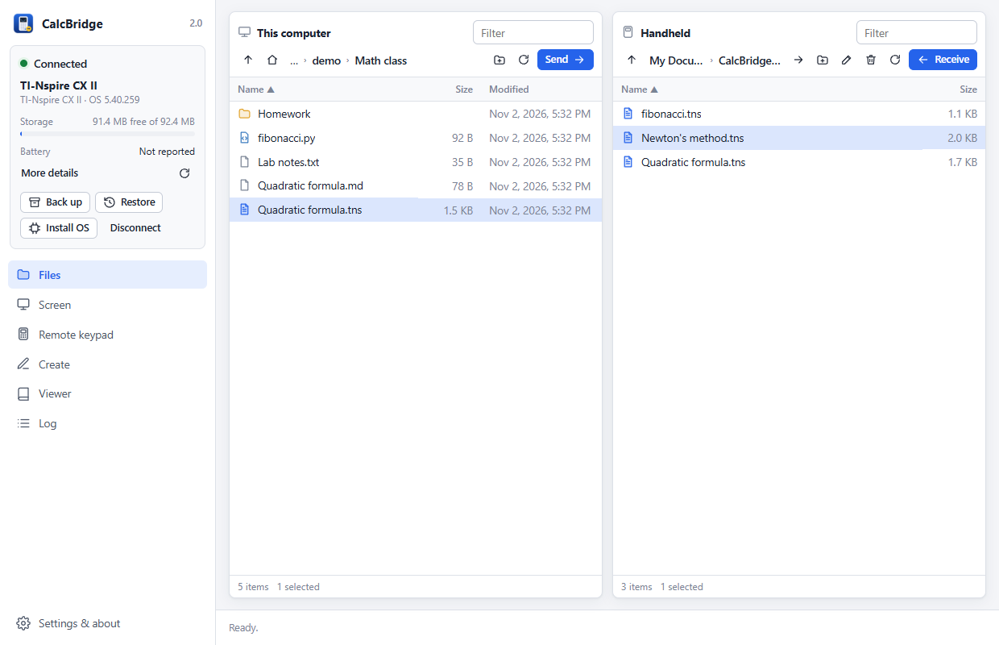
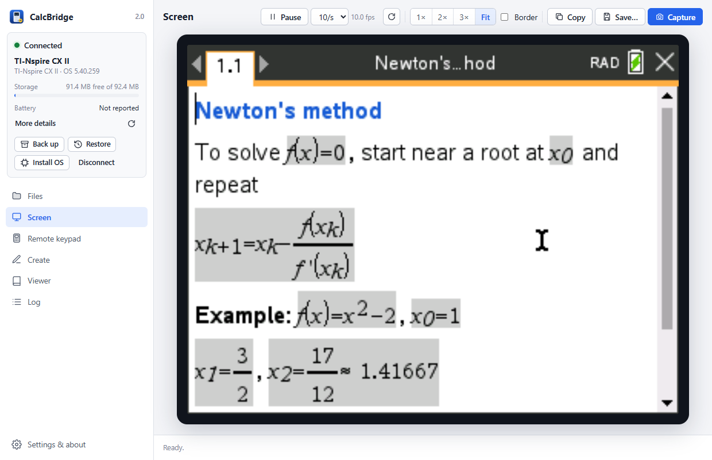
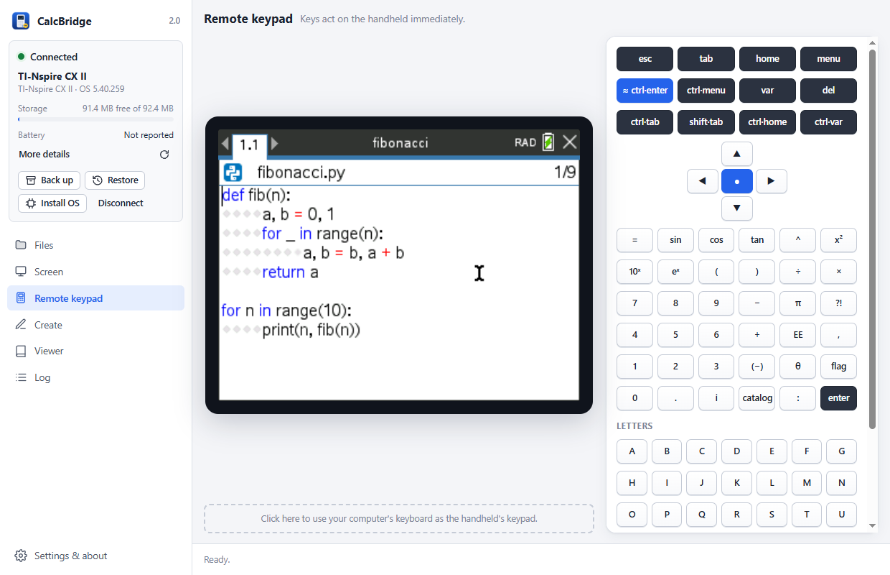
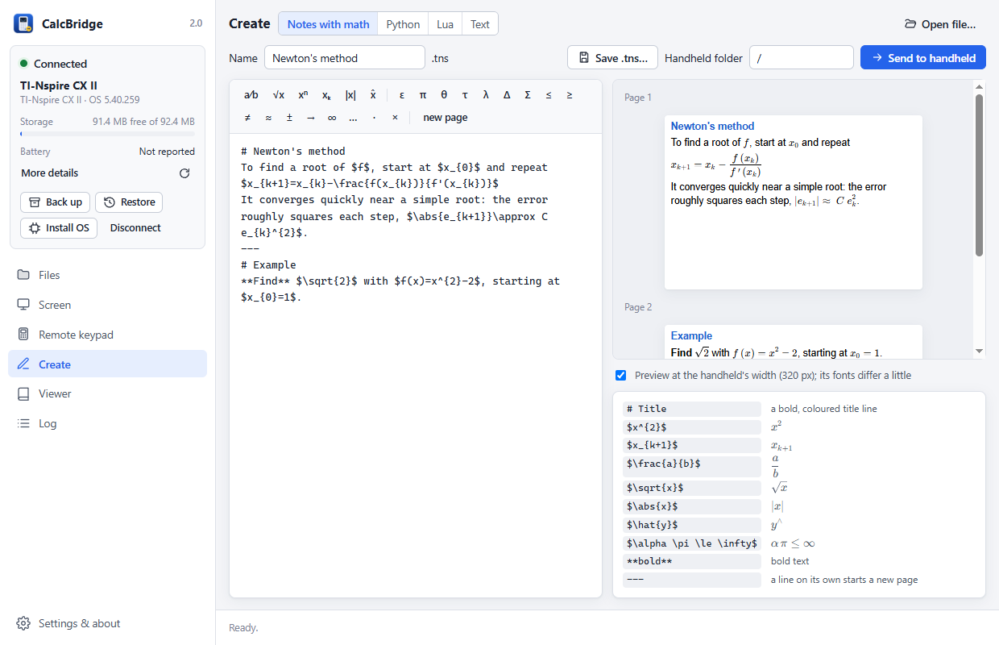
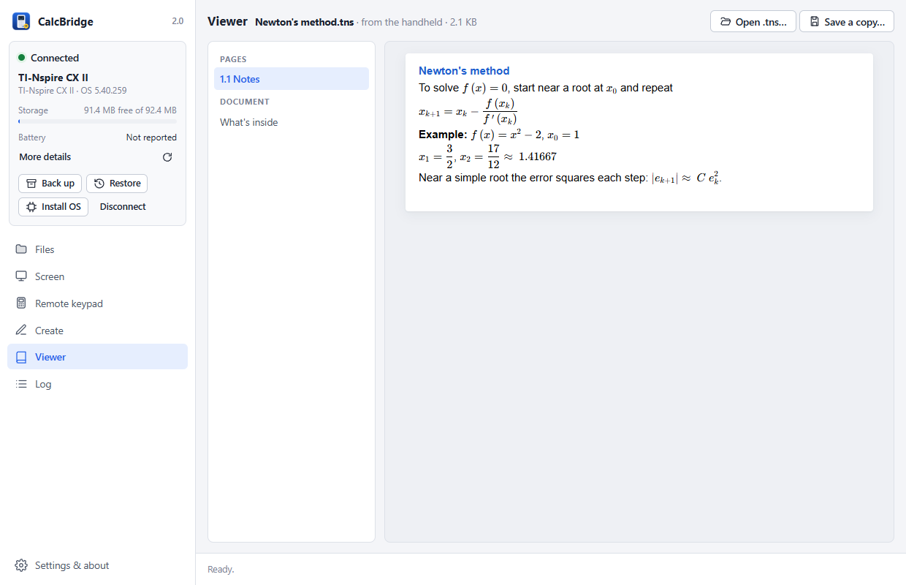
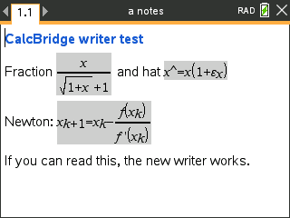

# CalcBridge

**A free, open-source desktop app for the TI-Nspire CX II** — move files, watch and control the
handheld's screen, back up, install OS updates, and build documents with real 2D math — on Windows,
macOS and Linux, with no TI account or license key.



> CalcBridge is an independent project. It is not affiliated with or endorsed by Texas Instruments.
> TI-Nspire is a trademark of Texas Instruments.

## Download

Get the latest build from the [Releases page](https://github.com/PerChance-Lee/calcbridge/releases):

| System | File | Notes |
|---|---|---|
| Windows 10/11 (64-bit) | `CalcBridge-windows-x64-setup.exe` | Installs for you only, no admin rights needed. (`.msi` for managed installs.) No driver needed. |
| macOS 11+ on Apple silicon | `CalcBridge-macos-arm64.dmg` | Drag CalcBridge to Applications. See *Opening on a Mac* below. |
| macOS 11+ on Intel | `CalcBridge-macos-x86_64.dmg` | Same as above. |
| Linux (x86-64) | `CalcBridge-linux-x86_64.AppImage` or `.deb` | The `.deb` installs a udev rule so you can use the calculator without root. |
| Command line only | `calcbridge-cli-*.zip` / `.tar.gz` | One file, no installer. |

**Windows SmartScreen** may say it protected your PC, because the installer isn't code-signed yet: click
**More info › Run anyway**.

**Opening on a Mac:** the app isn't notarized by Apple, so the first launch is blocked. Double-click it,
choose **Done**, then open **System Settings › Privacy & Security**, scroll down and click **Open Anyway**.
Or, in Terminal: `xattr -dr com.apple.quarantine /Applications/CalcBridge.app`.

## What it does

Plug the calculator in with its USB cable and turn it on — CalcBridge connects by itself.

| Task | How | Status |
|---|---|---|
| Connect | Automatic when you plug in (USB hotplug), and again after a re-plug; picks up a connection another program left open | ✅ tested on a CX II |
| Handheld info | Name, OS and boot-loader versions, product ID, storage and memory | ✅ tested on a CX II |
| Browse | Side-by-side *This computer* / *Handheld* panes, sortable, filter box, folders first | ✅ tested on a CX II |
| Send files | Drag from Explorer/Finder or the left pane, **Send**, or **Send files…**; folders too; *Replace / Skip* when names exist | ✅ tested on a CX II |
| Receive files | Drag to the left pane or **Receive** (files and whole folders) | ✅ tested on a CX II |
| Organise | New folder, rename (F2, keeps `.tns`), delete (Del, recursive), copy/cut/paste, duplicate ("Copy of …"), move by drag, properties | ✅ tested on a CX II |
| Convert on the way in | `.py` → Python program, `.lua` → Lua script, `.md` → Notes page with math, `.txt` → Notes page (the handheld only accepts `.tns`) | ✅ on the simulator; same documents as Create |
| Live screen | The handheld's screen at about 10 frames a second, zoom 1–3× or fit, captures strip, copy, save PNG/JPEG with TI's grey border | ✅ tested on a CX II |
| Remote keypad | Click the on-screen keys or type on your keyboard while watching the screen | ✅ tested on a CX II |
| Create documents | Notes with **real TI math boxes** (fractions, roots, powers, subscripts, Greek and symbols) from simple markup with a live preview, several pages; Python programs; Lua; plain text | ✅ Notes, Python and Lua opened on a CX II |
| Python modules | **Install as module** puts the program in `PyLib` so other programs can import it | ✅ on the simulator |
| View documents | Open any `.tns` (yours or TI's) to see its pages, read Notes with their math, and save its Python or Lua code | ✅ reads TI-made documents |
| Back up / restore | Copy everything to a dated folder; restore keeping or replacing existing files | ✅ tested on a CX II |
| OS update | Install a `.tco2` / `.tcc2` / `.tct2`, with a check that the file matches the model, then reconnect after the restart | ⚠️ implemented from libnspire and tested on the simulator only — never run on real hardware |
| Command line | Everything above, scriptable (`calcbridge --help`) | ✅ tested on a CX II |

| Live screen | Remote keypad |
|---|---|
|  |  |
| **Create** — markup on the left, the handheld's pages on the right | **Viewer** — a document from the handheld |
|  |  |

**Not possible over USB** (no known protocol): renaming the handheld, reading the battery level (the CX II
reports it as unknown), exiting Press-to-Test, and TI's document engine features (editing Graphs pages,
the emulator). Older CX / CX CAS models (USB PID `0xE012`) use a different link layer and aren't
supported yet. The Mac and Linux builds are built and self-tested in CI but haven't been tried with a
real calculator yet — reports welcome.

## Writing math

In **Create › Notes with math**, each line is a paragraph. A line starting with `# ` is a bold, coloured
title, `**bold**` is bold, a line of `---` starts a new page, and anything between `$ … $` becomes a TI
math box:

| Markup | Shows |
|---|---|
| `$\frac{a}{b}$` | fraction |
| `$\sqrt{x}$` | square root |
| `$x^{2}$`, `$e^{x}$` | powers |
| `$x_{k+1}$` | subscripts |
| `$\abs{x-y}$` | absolute value |
| `$\hat{x}$` | x-hat (drawn as x^ — the handheld's fonts have no hat accent) |
| `$\alpha \pi \theta \le \ge \ne \approx \pm \to \infty \cdots$` | Greek letters and symbols (or type `α π ≤ …` directly; the Insert bar has buttons) |

Example: `**Newton:** $x_{k+1}=x_{k}-\frac{f(x_{k})}{f'(x_{k})}$` — this is how it looks on a real CX II:



## Command line

```
calcbridge devices                       connected calculators
calcbridge info                          handheld details
calcbridge ls [-r] [/folder]             list
calcbridge get /remote [local]           download a file or folder
calcbridge put local... /folder [-f]     upload (-f replaces)
calcbridge mkdir|rm|mv|cp ...            organise
calcbridge shot screen.png               screenshot (.png, .jpg, .bmp)
calcbridge backup FOLDER                 copy everything to a folder
calcbridge restore FOLDER [/remote]      upload a backup
calcbridge install-os FILE.tco2          install an OS
calcbridge key esc home down*3 enter     press keys (calcbridge keys lists them)
calcbridge type "2+2"                    type text
calcbridge build notes.md|prog.py        make a .tns (no calculator needed)
calcbridge view doc.tns [--extract DIR]  describe a .tns
```
Add `--sim` to try any command against the built-in simulated calculator, and `--trace` to see every
packet. On Windows, run it from PowerShell or Command Prompt (Git Bash rewrites a bare `/` argument;
CalcBridge repairs paths it recognises).

## Troubleshooting

- **"The calculator isn't answering"** — unplug it, plug it back in. (The CX II only restarts its side of
  the connection when it is plugged in again.)
- **"Can't open the calculator"** — another program has it. Quit TI-Nspire software or another copy of
  CalcBridge.
- **Linux: no calculator found** — install the `.deb`, or copy `packaging/linux/60-calcbridge.rules` to
  `/etc/udev/rules.d/` and re-plug the calculator.
- Files that aren't `.tns` don't appear in the handheld's own file browser, even though they're stored.
- **Log** (in the sidebar) shows what CalcBridge did; **Copy** puts it on the clipboard for a bug report.

## How it works

CalcBridge speaks the calculator's USB protocol directly — a Rust port of
[libnspire](https://github.com/Vogtinator/libnspire) plus the keypress service from
[tilibs](https://github.com/debrouxl/tilibs), over [nusb](https://github.com/kevinmehall/nusb) (no
libusb, no driver) — and reads and writes `.tns` documents itself. The details, including several
behaviours of the CX II found by testing, are in [docs/PROTOCOL.md](docs/PROTOCOL.md).

| Part | What's in it |
|---|---|
| `crates/link` | USB link layer, NavNet services, the high-level `Calculator`, and a simulator that reproduces the real handheld's quirks |
| `crates/tns` | `.tns` container, encryption and TIXC codec; Notes with math boxes; the math display model |
| `crates/cli` | the `calcbridge` command line |
| `app` | the desktop app: [Tauri 2](https://tauri.app) (Rust) with a React + TypeScript interface and [KaTeX](https://katex.org) for math |

CalcBridge 1.x was written in Python with Qt; 2.0 is a rewrite in Rust that is faster (a 100 KB file
reads in a third of a second, the screen streams at ~10 fps), smaller to download, and connects by itself
when you plug in. The 1.x source is in the [`v1.0.0` tag](https://github.com/PerChance-Lee/calcbridge/tree/v1.0.0).

## Developing

You need [Rust](https://rustup.rs) (1.85+) and [Node.js](https://nodejs.org) 20+. On Linux, also the
WebKitGTK development packages (see `.github/workflows/ci.yml`).

```
cargo test --workspace                     # protocol, simulator, document and CLI tests
cd app && npm install && npx tauri dev     # the app, with live reload
npx tauri dev -- -- --sim                  # ...against the simulated calculator
npx tauri build                            # installers in target/release/bundle
cargo run -p calcbridge-cli -- --sim ls -r /
```

With a CX II plugged in, `CALCBRIDGE_HARDWARE=1 cargo test -p calcbridge-link --test hardware -- --nocapture`
runs the end-to-end tests on it, inside a scratch folder that is removed afterwards.
`CalcBridge --self-test` checks a packaged build without opening a window.

## License

GPL-3.0-or-later (it ports libnspire, which is GPL). Third-party credits and licenses:
[THIRD_PARTY.md](THIRD_PARTY.md).
